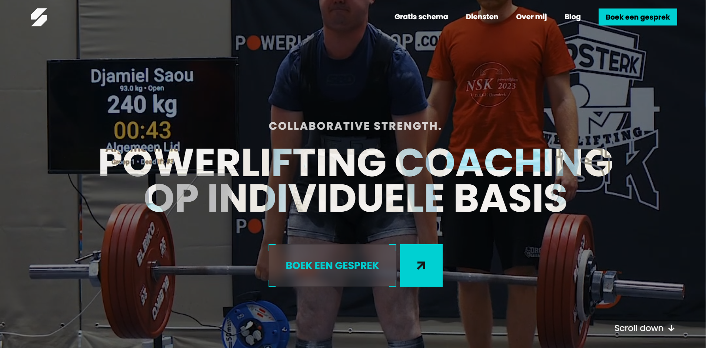

# Collaborative Strength

Website voor mijn powerlifting coaching op individuele basis. Ontworpen in Figma en gebouwd met Next.js, Tailwind CSS en Framer Motion.



**Live:** [colaborative-strength-website.vercel.app](https://colaborative-strength-website.vercel.app/)  
**Case study:** [Collaborative Strength in mijn portfolio](https://portfolio-kappa-gilt-e200sltsky.vercel.app/work/collaborative-strength)

## Over het project

Atleten weten vaak niet wat ze van een coach kunnen verwachten, en elke coach werkt anders. Mijn coaching is een samenwerking: we maken het plan samen, op basis van jouw input. De website legt uit hoe dat werkt, zodat de juiste mensen een gesprek boeken en anderen zien dat het niet bij ze past.

De site is bedoeld voor mensen die via Instagram interesse hebben gekregen en meer willen weten. Een gratis kennismakingscall is vanaf elke pagina te boeken.

## Pagina's

- **Home** – de vraag aan de bezoeker, de vier stappen (ambitie, aanpak, SBD, reflect) en "Focus zonder chaos"
- **Diensten** – hoe de coaching in elkaar zit, als tijdlijn
- **Over mij** – ervaring, waar de passie begon en mijn visie op coachen
- **Blog** – overzicht van blogposts
- **Contact** – formulier om een gratis call te plannen

## Wat ik heb gebouwd

- **Animaties** met Framer Motion: parallax-foto's, fade-ins en tijdlijnen die meegroeien tijdens het scrollen
- **Een menu dat zich aanpast**: boven witte secties wordt het frosted glass met donkere tekst
- **Een knop met hover-effect**: de hoeken schuiven, de knop vult zich en de pijl draait
- **Responsive**: op mobiel een volledig schermmenu en aangepaste layouts

## Technische stack

   

## Projectstructuur

```
src/app/
├── page.js              # Home
├── diensten/page.js
├── about/page.js        # Over mij
├── blog/page.js
├── contact/page.js
├── components/          # Gedeelde componenten (Navbar, Button, PageHero, ...)
│   ├── about/
│   ├── blog/
│   ├── contact/
│   └── diensten/
├── globals.css
└── layout.js
public/                  # Afbeeldingen, logo en achtergrondvideo
figma spullen/           # Exports uit het Figma-ontwerp
```

## Lokaal draaien

```bash
git clone https://github.com/djamiel-dev/colaborative.git
cd colaborative
npm install
npm run dev
```

Open daarna [http://localhost:3000](http://localhost:3000).

## Nog te doen

- Gratis schema
- Blogposts inhoudelijk uitwerken
- Het boekingsformulier echt laten versturen

## Deployment

De site draait op Vercel. Elke push naar `main` wordt automatisch live gezet.
